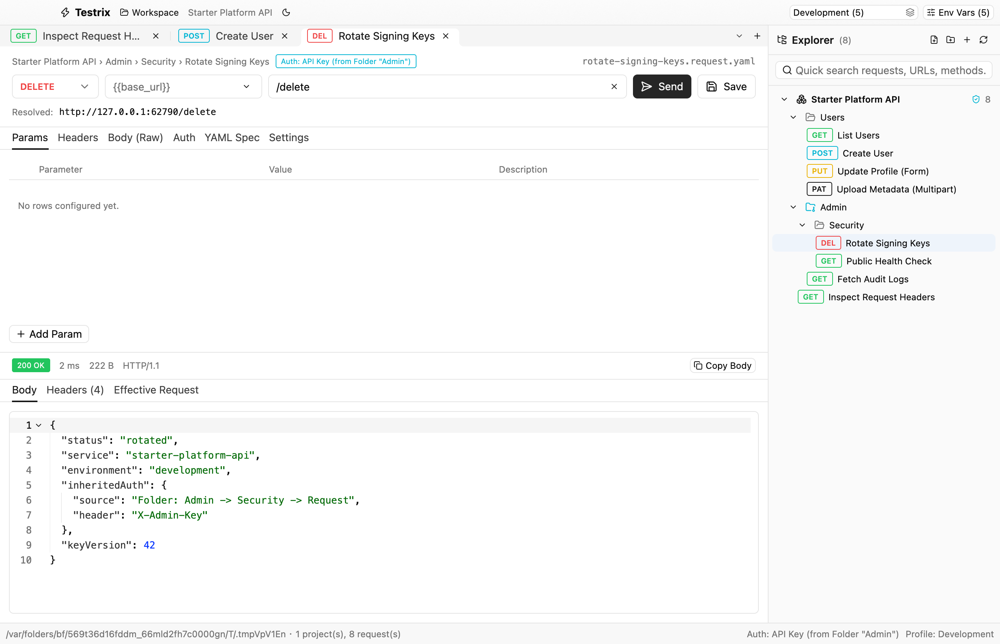

# Testrix

A native desktop API client and YAML-backed request workbench built with **Rust** (`1.100.0`) and **GPUI Kit (`v0.10.0`)**.



## Highlights

1. **Top-right Profile & Environment Variables**: Active profile selector (`Development`, `Staging`, `Production`, `No Environment`) and a dedicated environment variables drawer (`Env Vars`) anchored in the top-right corner, supporting `{{variable}}` interpolation and masked secret variables.
2. **Right-side Project & Request Explorer with Quick Search**: Hierarchical explorer (`Project -> Folder -> Subfolder -> HTTP Request`) positioned on the right with live filtering across request names, HTTP methods, and URLs (`Cmd+K` / `Ctrl+K`).
3. **Center Tabbed Workbench**: Open multiple HTTP requests, Project settings, and Folder settings as tabs with dirty indicators, method badges, and resizable Request / Response split panes.
4. **Full HTTP Request & Body Support**: `GET`, `POST`, `PUT`, `DELETE`, `PATCH`, `HEAD`, `OPTIONS` with toggleable Params, Headers, and Body modes (`None`, `JSON`, `Raw` Text/XML/HTML/JS/YAML, `x-www-form-urlencoded`, `Multipart` text + file, and `Binary`).
5. **Cascading Auth Inheritance (`Project -> Folder -> Request`)**: Configure authentication (`Bearer Token`, `Basic Auth`, `API Key`, `No Auth`, or `Inherit from parent`) at the Project, Folder, or Request level, with live inheritance-chain inspection and one-click parent navigation.
6. **YAML-First Storage (`testrix.io/v1`)**: Every HTTP request is stored on disk as its own `*.request.yaml` document alongside `testrix.project.yaml`, `_folder.yaml`, and `environments/*.env.yaml`. See the full normative specification in [docs/yaml-spec.md](docs/yaml-spec.md).

## Workspace Architecture

- `crates/testrix-core` — Pure domain models, auth inheritance resolution, `{{var}}` interpolation, request materialization, and explorer filtering (`thiserror`).
- `crates/testrix-storage` — Atomic YAML persistence, directory scanner, validation, and starter workspace seeding (`yaml_serde`, `thiserror`).
- `crates/testrix-http` — Async HTTP execution engine on `reqwest` + `tokio` with `CancellationToken` support (`thiserror`).
- `crates/testrix-app` — GPUI Kit desktop application (`testrix` binary) and UI integration tests (`anyhow`, `tracing`).

## Toolchain & Running

This repository pins Rust `1.100.0` via [`rust-toolchain.toml`](rust-toolchain.toml).

If your shell PATH has a separate system/Homebrew `rustc` ahead of rustup, prepend rustup's shim bin directory (e.g. `/opt/homebrew/opt/rustup/bin`):

```bash
export PATH="/opt/homebrew/opt/rustup/bin:$PATH"

# Run Testrix (seeds ~/.testrix/workspace on first launch)
cargo run -p testrix-app

# Or point to a custom workspace directory
cargo run -p testrix-app -- --workspace /path/to/workspace

# Run all workspace unit, HTTP, storage, and GPUI headless UI integration tests
cargo test --workspace

# Run strict clippy & formatting checks
cargo fmt --check
cargo clippy --workspace --all-targets -- -D warnings
```
